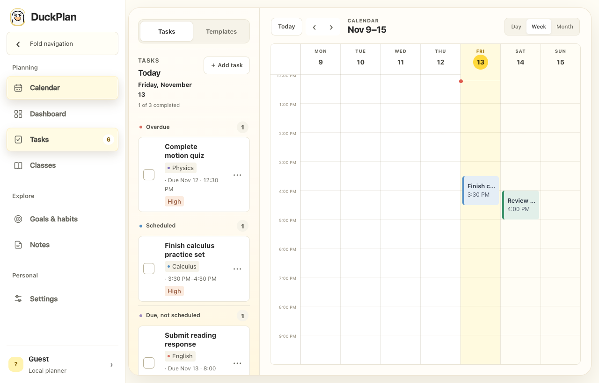
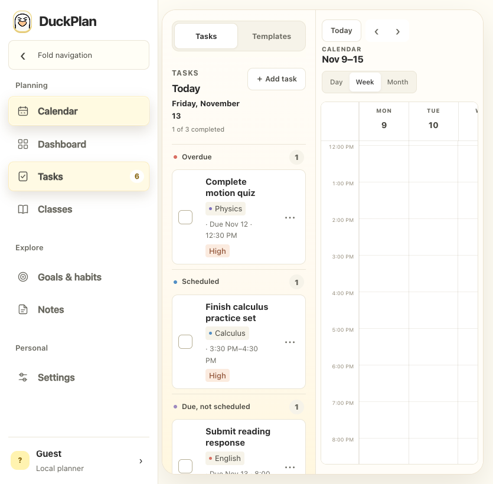
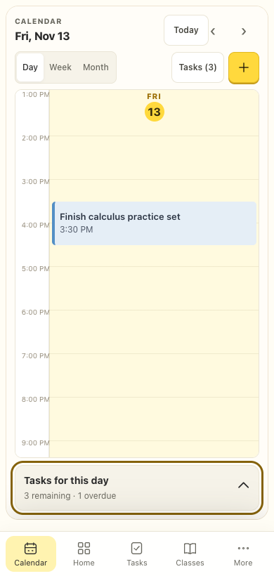
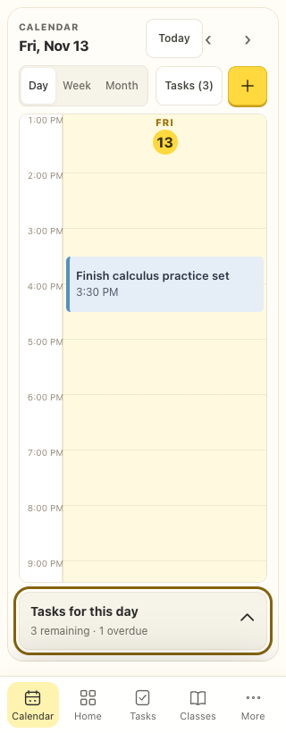

# Directional section navigation

Implemented November 13, 2026 in the local website checkout.

Sidebar navigation follows its actual visible order: Calendar, Dashboard, Tasks, Classes, Goals & habits, Notes, Settings. A destination below the current section slides downward into place from 48px above; a destination above slides upward from 48px below. Incoming content also fades in using the shared 480ms layout response. The sidebar stays still. Phone navigation uses the same section order.

Routes, selected navigation state, controls and scroll reset commit immediately. Initial/deep-link loading, same-section clicks, search and notification routing do not play an entrance animation. Reduced motion switches immediately and changing that preference stops any active slide. The two older CSS entrances are disabled so they cannot compete or retain a transform.

Only the incoming live section is animated; no outgoing forms, controls or IDs are cloned. Rapid navigation cancels old animation/completion work. Keyboard navigation retains its launcher focus; a shortcut inside outgoing content transfers focus to the destination workspace. Keyboard focus, scrolling, resize and page exit settle motion. A pointer press pauses its moving target through release, then click capture settles it before popup anchor measurements. Outside release, pointer cancellation and window blur clean up held motion. Duplicate pointer releases cannot leave a stale timer that cancels a new route.

## Verification

- 46 focused Node tests passed: section-transition behavior/lifecycle, routing, shared motion, button families, popup engine, PWA shell and versioned/offline caching. The new transition suite includes rapid reversal, stale completions, reduced/unsupported motion, pointer hold/click, outside and duplicate releases, and listener cleanup.
- `navigation-qa.js` runs through Playwright MCP `browser_run_code_unsafe.filename` against the existing loopback preview on port 8034. Each fixture uses a fresh isolated context, blocks service workers, and forbids API/external requests.
- Eight browser cases passed: widths 1280, 835, 390 and 320px, each with normal/reduced motion. Phone contexts enable mobile/touch emulation. Frame measurements at 0/120/480ms prove physical down/up travel and final opacity. Adjacent section directions, folded/expanded sidebar, keyboard Enter/focus, rapid route reversals, same-route/startup, content-shortcut focus, runtime preference changes and immediate phone Tasks-sheet taps passed. One active section remains, with no retained transform or horizontal page overflow. Zero page errors or prohibited requests.
- Actual open 835px in-app preview reloaded and verified through native UI clicks: Calendar → Tasks reported `down` with an initial −46.06px transform; Tasks → Calendar reported `up` with +46.06px. Existing planner data was preserved.
- JavaScript syntax and diff checks passed. Cache keys advanced and the offline shell includes `view-transitions.js` in PWA cache v35.

The screenshots show settled layouts; they do not by themselves prove motion. Phone/iPad sizes were tested in Chromium, not on physical Safari devices. No public deployment or native app synchronization is included.

