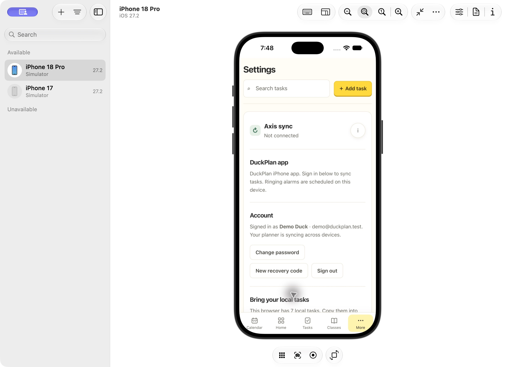
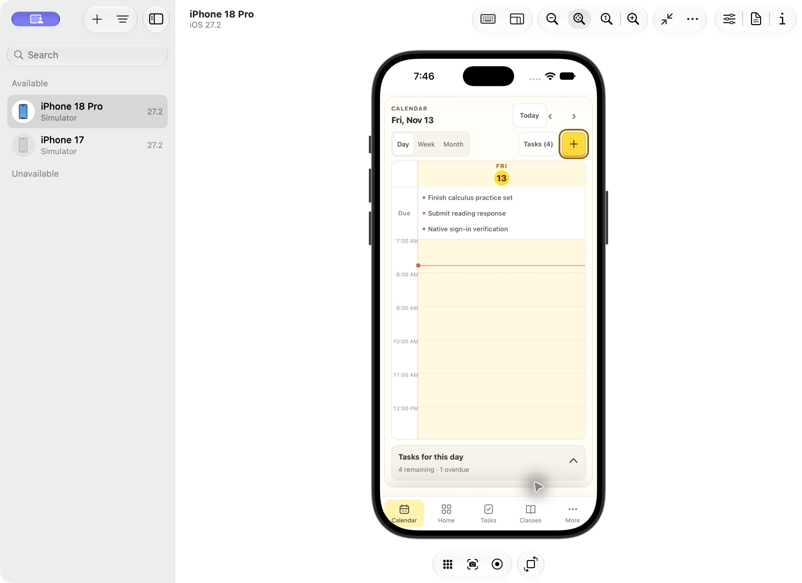

# Native account sign-in verification — November 13, 2026

The existing `DuckPlan-iOS` project now connects its bundled planner to the existing DuckPlan account backend. The current layout, approved v11 icon, native alarm presentation and signing customizations are preserved. A separate `codex/ios-cloud-signin` backup branch includes that previously uncommitted local app work as well as the account connection; it is not a public deployment or a main merge.

## Using the updated app

Build and Run the existing `ios/DuckPlan.xcodeproj` on the iPhone, then open **More → Settings → Account**. Use the same DuckPlan email/password as the website. Apple Developer/Xcode sign-in is unrelated. Google sign-in is not offered in the bundled app.

The app loads its own local web files and reaches `https://duckplan.duckplan-cloudflare.workers.dev/api` through a native URLSession client. Cookie headers remain outside JavaScript. Only bundled main-frame messages and requests to that API origin are accepted; redirects, foreign destinations, unsupported methods and oversized request bodies are rejected. The existing public server's CORS and CSRF behavior was not changed.

Account tasks refresh when the app resumes and every 30 seconds while foregrounded. Importing local demo tasks requires the existing explicit Import action. AlarmKit alarms remain on each device and are not copied from website notifications. Remote completion cannot cancel an alarm while the native app is closed; reconciliation occurs when it next refreshes.

## Checks passed

- All **219 Node tests**, including native transport with the actual Worker/SQLite backend: create/sign-in, wrong password, saved tasks, restored session and sign-out.
- Native Foundation boundary tests compiled from the actual Swift client: host, scheme, port, userinfo, fragment, API path, OAuth/live exclusion, method allowlist, body bounds and redirect rejection. No production requests are sent by this test.
- Unsigned Debug generic iPhone and iOS Simulator builds using the existing Xcode project. No warnings/errors in either final build log.
- All **93 bundled web files match source byte for byte** in both final builds.
- Existing `DuckPlanApp.swift`, `TaskAlarmStore.swift`, shared metadata, widget, Info.plists, Xcode project/signing configuration and v11 native icon match the hashes recorded before account work began. The native account implementation changes only `PlannerWebView.swift`.
- JS syntax checks for native cloud/config/store/app/install/service-worker scripts and `git diff --check`.

Commands:

```sh
node --test tests/*.test.cjs tests/*.test.mjs
node ios/scripts/test-cloud-boundary.mjs
xcodebuild -project ios/DuckPlan.xcodeproj -scheme DuckPlan -configuration Debug -destination 'generic/platform=iOS' -derivedDataPath /private/tmp/DuckPlanNativeCloudBuild CODE_SIGNING_ALLOWED=NO build
xcodebuild -project ios/DuckPlan.xcodeproj -scheme DuckPlan -configuration Debug -destination 'generic/platform=iOS Simulator' -derivedDataPath /private/tmp/DuckPlanNativeCloudSimBuild CODE_SIGNING_ALLOWED=NO build
```

## Actual simulator checks

Used iPhone 18 Pro on iOS 27.2 and an isolated loopback Wrangler backend at port 8792. The Debug simulator-only environment override points to `http://127.0.0.1:8792/api`; physical-device and Release builds ignore it and use production HTTPS.

1. Signed in with the repository's fictional seeded account. Settings showed **Demo Duck / demo@duckplan.test** and cloud syncing. Actual native URLSession requests returned sign-in 200 and planner 200.
2. Terminated the app at the earlier checkpoint and relaunched it the following day. It restored the correct authenticated identity without entering credentials again.
3. Installed the final rebuilt simulator app over the existing app. The session was retained and the updated Settings text appeared.
4. Created “Native sign-in verification” in the final native app. It appeared in Calendar; the local Worker confirmed the item PUT returned 200.
5. Used Sign out. The Worker returned 200; Settings cleared the identity and restored the empty email/password form.





## Limits and release status

Physical-phone installation and actual production-account sign-in on that phone remain a separate Xcode Run/test step. No personal credentials, production account changes, cloud migrations, server deployment, main merge or new signing permissions were used. The existing production anonymous session endpoint was checked read-only and offers email/password sign-in. No physical AlarmKit ringing result is claimed by this account work.

Final logs remain in `/private/tmp/duckplan-native-cloud-all-tests-final.log`, `duckplan-native-cloud-build-final.log` and `duckplan-native-cloud-simulator-build-final.log`. The initial stopping-point history is retained in `CHECKPOINT.md`.
