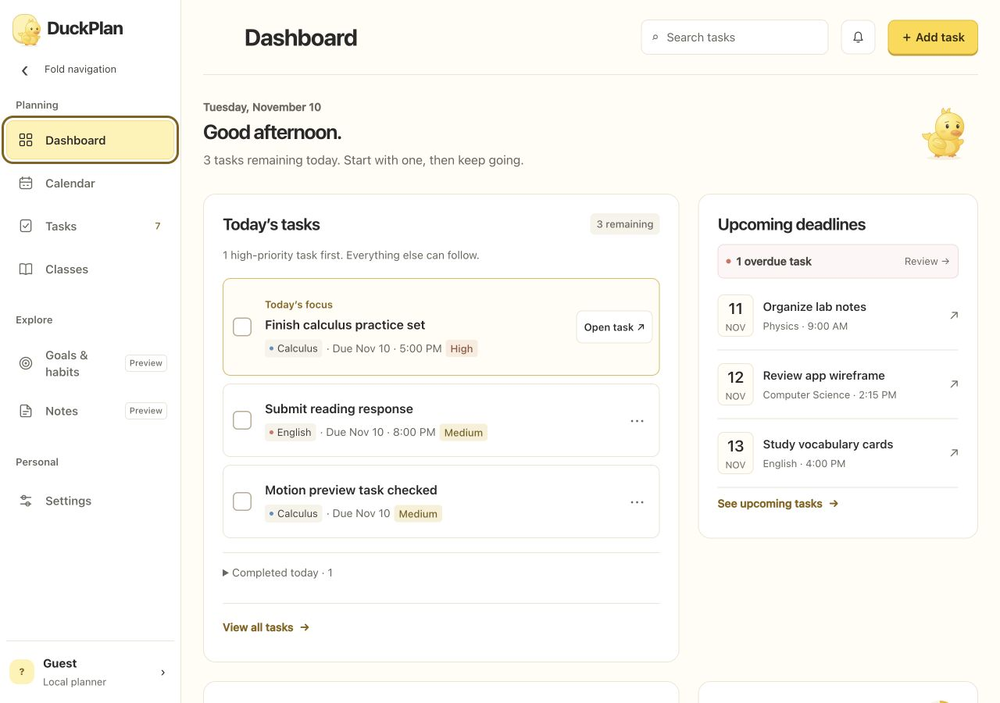
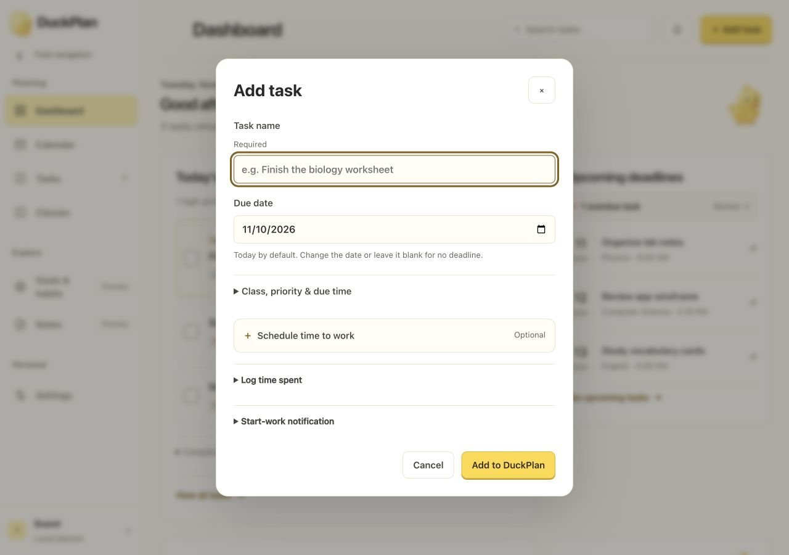
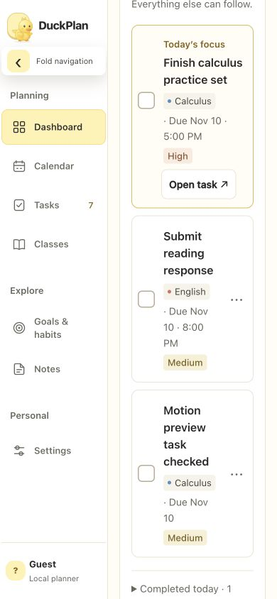

# Separate sidebar and popout version

Branch: `codex/sidebar-popup-merge`. Base: `5f44086`, which includes the new shared-main layout (`f2b3426`) and the pending account-name fix from PR #17. This version is separate from main and has not been publicly deployed.

## Behavior

- The navigation dock pushes the workspace between a 64px icon rail and a 232px panel. Its internal layout stays fixed throughout the transition. On narrow phones those widths are 52px and 152px.
- Folded icons remain usable, with hover tint, press feedback and keyboard focus. Expanding does not add a scrim or make the workspace inert.
- Workspace container queries let cards and controls reflow as the available area changes.
- Task dialogs reuse the earlier nine-piece shell animation, starting at the actual launcher, then revealing fields at the final bounds. Closing resolves the fields and retraces the shell to the launcher. Save, Cancel, Escape, interrupted motion and viewport changes restore usable controls and focus.
- New layout colors, cards, typography, task fields and account identity remain in place. Task storage and backend contracts are unchanged.

## Validation

39 tests passed:

```sh
node --test tests/popup-motion.test.cjs tests/motion-tokens.test.cjs tests/button-interactions.test.cjs tests/planner-ui.test.cjs tests/pwa-app.test.cjs
```

`node --check` passed for `app.js`, `planner-presentation.js`, `planner-clarity.js`, `popup-motion.js` and `service-worker.js`. `git diff --check` passed.

Local browser checks at `http://127.0.0.1:8032/#home`:

- Desktop 1280×900: sidebar opens/closes while its internal width remains 232px; workspace moves between x=64 and x=232. No horizontal page overflow.
- Phones 390×844 and 320×844: expanded sidebar pushes the workspace; no horizontal page overflow. At 390px, the dialog is 362px wide and stays within the viewport with scrollable content.
- Task creation, editing and Save persist in the isolated localhost planner. Test task is named “Motion preview task checked”.
- Cancel and early Escape leave zero animation tiles, restore the visible launcher and return focus. Resizing an open dialog leaves it usable.
- Sidebar Enter activation and calendar next-period navigation work. Automated tests cover reduced motion, interruption, source removal, reverse endpoints and cold sizing.

These checks use the static local planner, not production accounts or backend services. Screenshots show local demo data. No native build or physical-device alarm test was needed for these web UI changes.

## Screenshots






