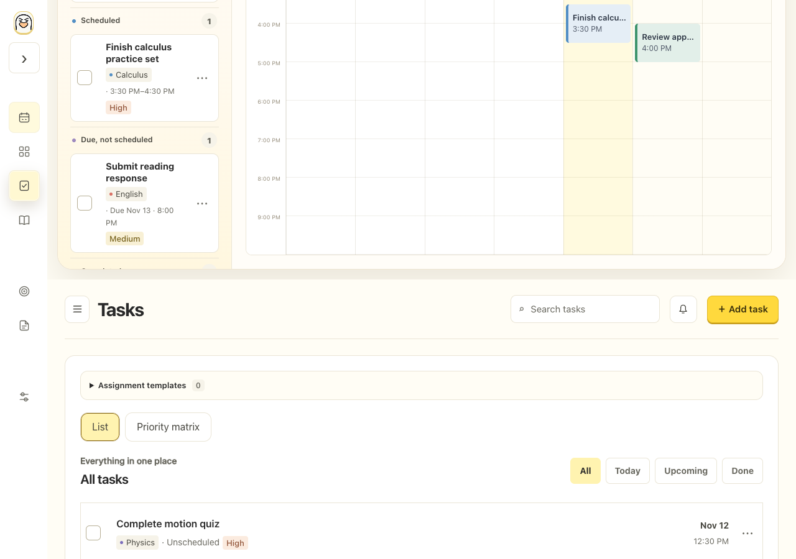
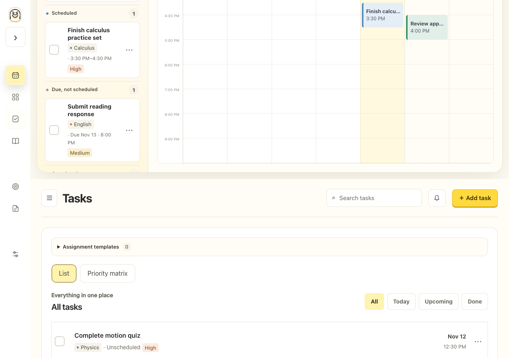
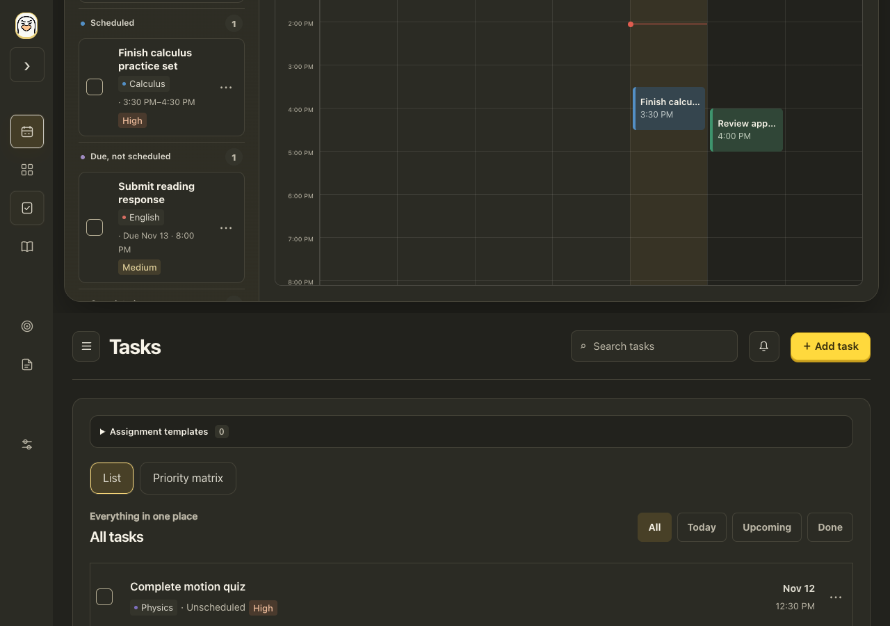

# Whole-page sidebar transitions

Implemented locally November 13, 2026, after the user approved the [Chat Check plan](../reviews/page-stack-transitions-2026-11-13.md). This replaces the earlier 48px incoming fade.

Later November13: the user requested a softer fading directional pull. The [new completed Chat Check](../reviews/fade-pull-transitions-2026-11-13.md) supersedes the full-height/no-fade visual acceptance below for the next revision. This document remains evidence for the current physical slide; the replacement has not been implemented.

Selecting a lower sidebar section moves the complete old workspace up and the new workspace in from below. Selecting an upper section reverses both signs. Native painted snapshots include the page header, task panel and content; both share one clipped viewport, 480ms layout timing and the same easing, with opacity fixed at one. Navigation stays outside the snapshots.

All desktop sections now share Calendar's existing 76px rail / 268px expanded navigation geometry. The outer workspace occupies one stable viewport, while non-Calendar content keeps its existing 1600px reading-width limit and page-specific scrolling/padding. Phone Calendar, bottom navigation and task-sheet layouts remain intact.

## Interaction and lifecycle

`applyView()` performs the authoritative route update inside the browser's capture callback, before snapshot animation starts. Direct `setView()` navigation remains unanimated for startup, search, notification/deep-link handling and other programmatic changes. No application action waits for the 480ms animation to finish.

One controller owns the visual pair. Pending and reentrant navigation, asynchronous capture/completion callbacks and owner changes are guarded so old work cannot commit or clean up a newer route. Popup opening, desktop pointer entry, content focus/keyboard, scrolling, sidebar resizing, window changes and page exit settle motion and clear transient state. Account changes cancel snapshots before replacing account content. Native dialogs/portal menus have a defensive observer as well as explicit popup settlement.

Captured snapshots are painted images, not live hit targets. The implementation therefore uses immediate navigation for coarse/touch devices, reduced motion, unsupported/failed snapshot APIs, content shortcuts, open modal/sheet contexts and navigation while the sidebar is still resizing. Desktop pointer movement into content settles the snapshot before a normal click. No synthetic tap is replayed against a different control. Keyboard navigation keeps its source focus; content shortcuts transfer outgoing focus to the live destination workspace.

The [native API reference](https://developer.chrome.com/docs/web-platform/view-transitions/same-document) and [CSSWG painting/hit-testing model](https://www.w3.org/TR/css-view-transitions-1/) informed the snapshot and touch-fallback choices. Touch devices intentionally keep instant functional navigation rather than attempting an unsafe animated-tap approximation.

## Verification

- All 317 Node tests pass. The replacement transition suite has 12 lifecycle regressions covering capture-time update, rapid/reentrant latest-wins behavior, owner guards, fallbacks, pointer/focus/preferences/window/popup settlement, native failures, update failures and listener cleanup.
- Actual 1280px browser measurement: main rectangle stayed x76/y0/1204×820. Calendar→Tasks moved old y0→−820 and new y+820→0; both opacity values remained one and both surfaces met continuously. This is full viewport travel, not the former 48px entrance.
- The actual open 835×747 preview was reloaded after confirming no in-progress edits. Settings→Calendar used the reverse stack; Calendar→Tasks used the forward pair with old/new offsets −30.6312/+716.369 for H747. The user's Settings view was restored. Phase/height state was cleared afterward; existing planner data was not changed.
- `qa.js` and its browser artifacts provide the responsive, interruption and normal-playback checks recorded with this implementation. Snapshot displacement is assessed using eased progress from real matrices, not by assuming that half the elapsed duration equals half-height travel.
- Fine-pointer native snapshots passed at 1280/835/390/320px in both directions, including held 10/50/90% eased-progress frames, expanded/distant section changes, and all seven settled sections at 835px with folded/expanded navigation. Both page surfaces stay opaque, share one hidden-overflow clip and retain one live view/form without navigation or horizontal movement.
- Touch 390/320px, reduced-motion and unsupported-API cases all navigated immediately without snapshots. Immediate Add Task and task-sheet taps worked. Rapid/reverse navigation, runtime preference changes, resize, content focus followed by Enter opening a popup, and owner-change cleanup passed with no final page errors or prohibited API/external requests. See `edge-qa-results.json`.
- A dark 1280px Calendar kept its actual internal scrollTop at 180 through forward/back navigation. The held midpoint measured old/new offsets −449.997/+450.003 for H900, with opacity one and a stable 76/0/1204×900 workspace clip.
- Normal unpaused playback produced a 30-frame elapsed trace (7.1–490.4ms) with maximum shared-boundary error .00049px; see `normal-raf-trace.json`. The [3.4-second recording](page-stack-playback.webm) includes forward/back and distant section changes. Its decoded frames were visually inspected alongside held frames; headers move with their complete pages. QA helper waits are bounded and await native readiness before finishing held animations.
- Syntax and diff checks pass. PWA cache v37 includes `page-stack.css` and the updated controller. The approved v11 icon hash is unchanged.

This is local website/TEST-branch work. It does not publish shared main, deploy a host, migrate databases or sync/install another iPhone app version. Chromium viewport/touch emulation is not physical Safari/iPhone/iPad verification.

