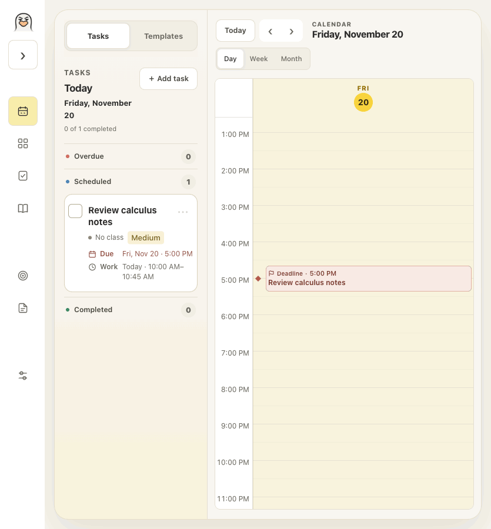

# Task pop-out continuity — November 15, 2026

Implemented locally on `codex/popup-content-morph-20261115`, based on `e350bd7`. This changes the website’s reusable task editor and compact Calendar task/deadline previews. Task dates, saving, account ownership and native app sources are unchanged.

The launcher keeps its original formatted text and icons at takeoff. Its rounded container expands while the source fades into the destination contents. The editor’s fields stay at their final size, preserving crisp text and native input behavior. Opening now takes one 320ms timeline instead of a 240ms expansion followed by a separate 120ms reveal. The source holds through 20%, fades out by 68%; destination content fades in from 52% through 96%, overlapping while geometry settles. Closing retains the guarded return to the launcher. The temporary snapshot is bounded to 80 nodes, strips IDs/event attributes/focus participation and excludes form input content; reduced motion bypasses it.

The expanding surface uses the destination’s actual light/dark material. Only transforms and opacity animate; there are no normal per-frame layout reads or animation loops. Source styling is read once at capture. Dynamic compact previews restore native responsive bounds after completion/cancellation; the reusable editor keeps its existing prepared geometry/focus system.

## Reference

Opened Google Calendar’s Create → Event window in a temporary Chrome tab, inspected its rendered motion styles and closed the empty draft without saving. In the observed version, the outer wrapper exposes a 400ms transform transition and the inner dialog a 200ms opacity transition. That is evidence for separating container travel and content opacity, not a claim that DuckPlan reproduces Google’s exact choreography. DuckPlan’s source-preserving crossfade implements the user’s requested behavior. No existing Google events were edited or saved; the temporary tab was closed.

Google’s official [Material container transform documentation](https://developer.android.com/reference/com/google/android/material/transition/MaterialContainerTransform) also distinguishes container motion from content fade behavior. The exact offsets above are DuckPlan’s implementation choices.

## Verification

- **PASS:** 69 focused Node tests covering popup lifecycle, circular corners/endpoints, interrupted animations, dynamic-preview responsive cleanup, preview owner/handoff guards, editor focus, shared motion tokens, PWA caching, task cards and timed-deadline integration. Output: `verification.txt`.
- **PASS:** actual Chromium 157.0.8103.78 at 1280/local,835/signed-in,390/signed-in and 320/dark/local. Each uses isolated storage; signed-in clients use fresh synthetic accounts against real localhost Worker 8796 with local migrations 0001–0008. Source snapshots preserve formatted content and remove deliberate fixture IDs/event attributes. Sampled source/content opacities demonstrate overlap during growth; native field transforms remain absent. Escape, early dismissal, reopen, resize, preview→Edit, save/reload, independent due/work times and reduced-motion previews pass. Phone Add opens an empty editor after prior edits. Evidence: `runtime.js`, `runtime-final.json`.
- **PASS:** phone touch grouped deadlines → compact preview → Reschedule, correct scheduled-date focus, Escape/focus restoration and exact task-data preservation after cancellation. Evidence: `runtime-edges.js`, `runtime-edges.json`.
- **PASS:** real SW 66 cache contains byte-matching popup JS, tokens and both changed stylesheets. Offline open/edit/save/reload and reconnect retain the edited task. This is browser service-worker testing, not an installed-PWA claim. Evidence: `runtime-extra.js`, `runtime-extra-final.json`.
- **PASS, bounded performance observation:** three uninterrupted open/close pairs show 16ms median frame gaps and no recorded long tasks. First open setup 22ms/max gap 27ms; warm open setup 9ms/max gaps17–18ms. Sampling runs contain no screenshot/scrubbing work. This does not guarantee every frame on physical devices or other browser engines.
- **PASS:** user preview 8034 refreshed to the four `content-morph-20261115` asset keys, left in Week/Sunday 15 with Tasks open and no draft. No user task records were edited. Owned synthetic browser contexts and Worker 8796 were stopped; the user’s existing preview remains running.
- **NOT RUN:** Safari/WebKit, Firefox, physical phone/iPad, installed PWA and native WKWebView. No native source sync, build or phone installation is part of this website-only change. No public deployment, remote migration or shared-main merge.

`source.json` records final source hashes, branch, base and cache key. The platform procedure now requires sampled source/destination continuity and dynamic-preview bounds cleanup.

## Visual proof

The GIF uses 21 scrubbed frames of the actual browser WAAPI animation, at 16ms sample spacing, with pauses at the beginning/end for viewing. It is a reproducible visual aid; the separate uninterrupted audit above supplies performance evidence. `final-window.png` and the four `tablet-*.png` captures use only synthetic planner records.

To reproduce, run the browser scripts with the project’s Playwright runner in isolated contexts. `runtime-extra.js` writes `frame-00.png` through `frame-20.png`; `render-gif.swift` combines those captures using macOS ImageIO. Raw frame files are disposable generated proof and are not included in the backup. The system ffmpeg executable could not export because its x265 dependency was missing; no system packages were changed.
