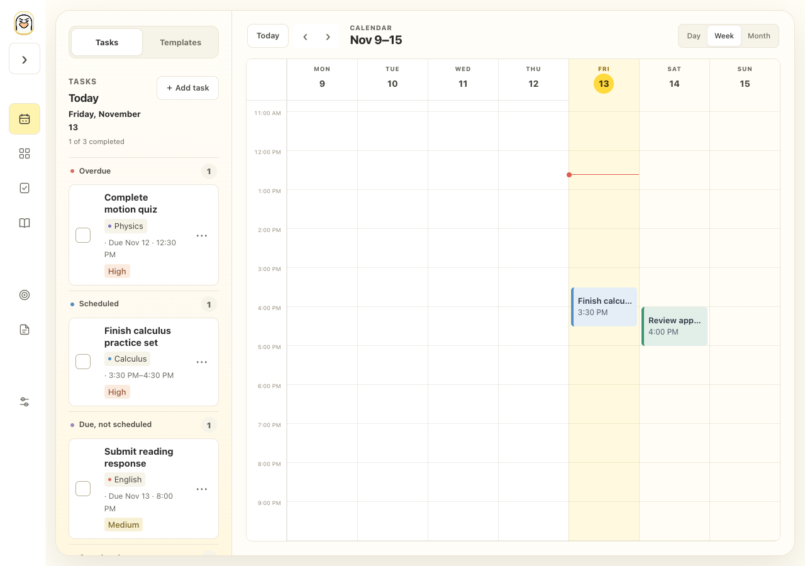
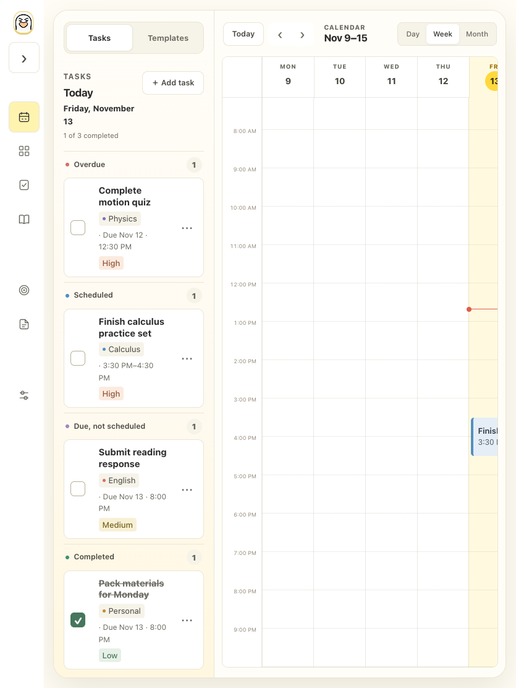
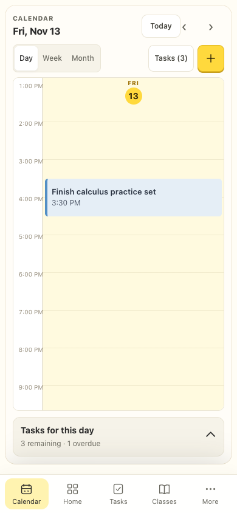
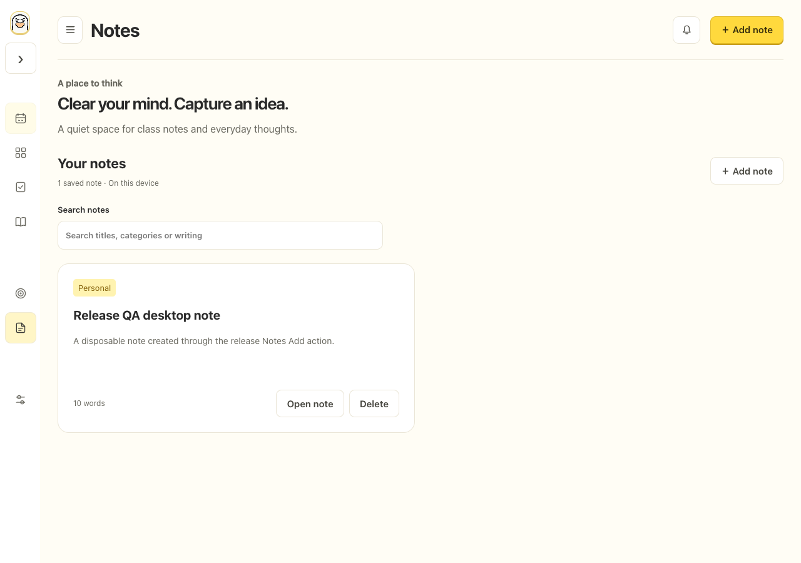
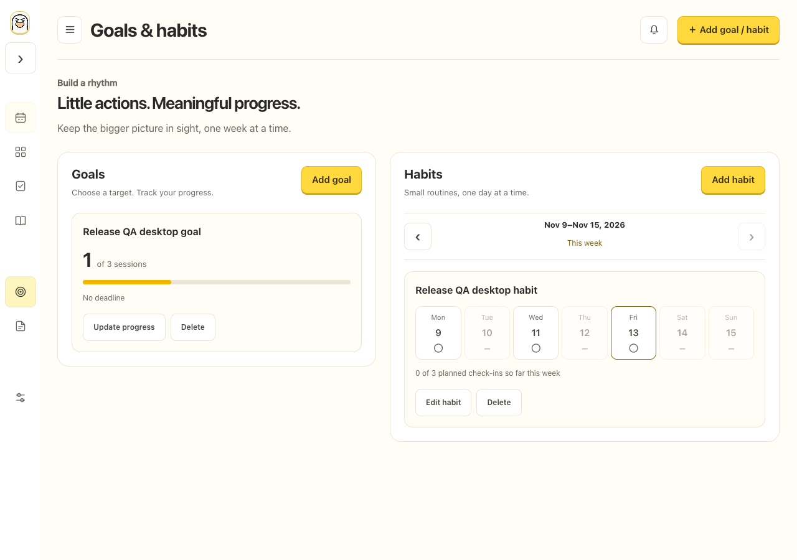
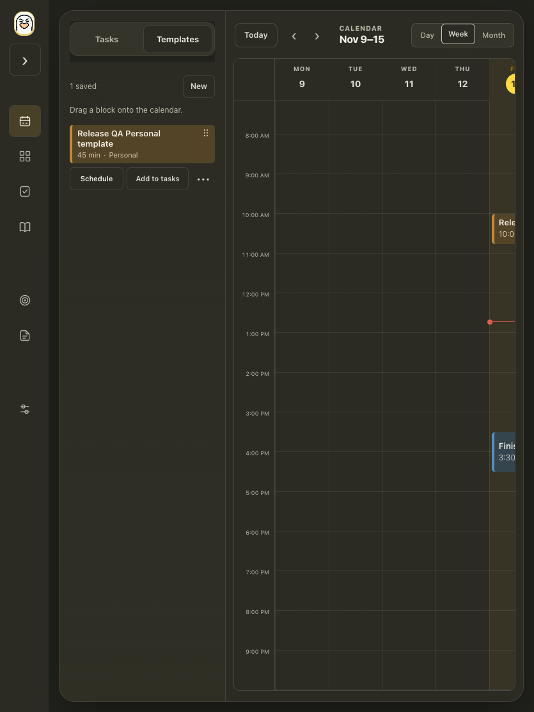
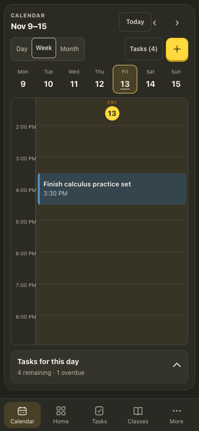

# Main-release browser checks, November 13, 2026

The isolated release preview runs on loopback port 8036. Both scripts use fresh synthetic contexts, block service workers and prohibit API/external requests; they do not read or modify the user's open browser data.

`browser-smoke.js` checks desktop 1280px, iPad 835px and touch phone 390px. Calendar opens by default, Templates is reachable, contextual Add creates a Note/Goal/Habit with the expected fields and type, data survives reload, and the seven initial tasks remain unchanged. The phone task sheet, bottom navigation and More menu work. All three sizes passed with no horizontal overflow. An initial iPad attempt lost three HTTP script responses and could not complete startup; its fresh isolated retry passed all remaining persistence checks with zero resets/errors.

`calendar-dark-smoke.js` checks the final `ad784be` shared-main integration. At 835px and 390px, dark Week/Day/Month retain the intended tablet/phone layouts, with no horizontal overflow. Personal template and scheduled event fill, accent, title and secondary colors match exactly. The dark board luminance measured .0237, with sampled heading/hour/date text contrast ratios 7.18–12.85. The phone Week selector retains all seven days. Final contexts reported no page/console errors or prohibited requests.

Normal desktop/phone checks preceded the dark-only shared-main delta; fresh iPad and both dark-mode size checks ran after integration. Screenshots show the inspected layouts. These Chromium checks do not claim physical Safari/iPhone/iPad behavior, signed-in hosted cloud operation or AlarmKit delivery.

