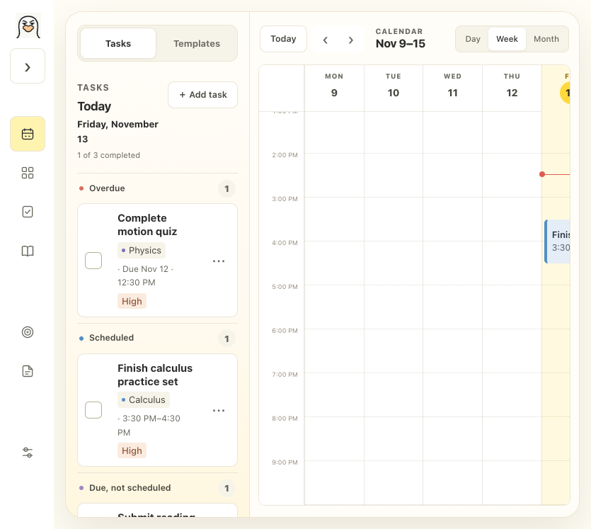
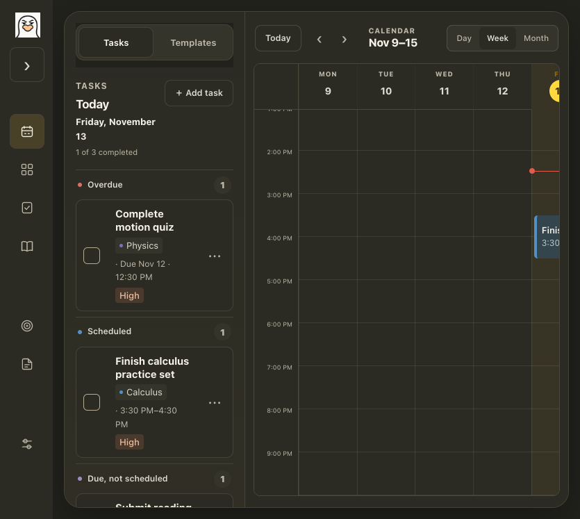
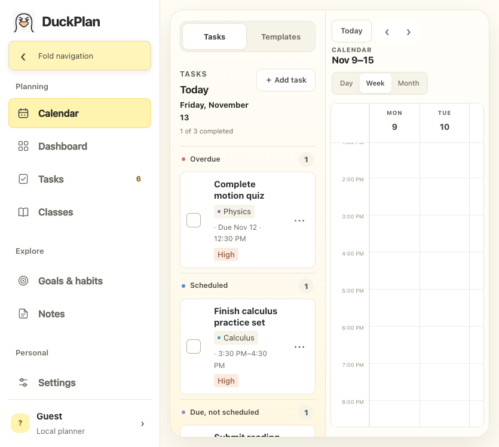

# Plain sidebar brand mark

November 13, 2026: removed the sidebar logo's gold border, yellow backing, rounded clipping and drop shadow. The approved square v11 artwork now displays at 36×36 with `object-fit: contain` and centered positioning, instead of being cropped into a 32×36 tile. No image pixels or artwork were edited.

The folded brand link fits its visible icon; expanded navigation keeps the label. Hover/press use a quiet image-opacity change without a raised frame. The existing keyboard focus outline and Enter navigation remain available. Reduced motion has no opacity transition.

Verification: six focused button/PWA tests and diff checks pass. Isolated 835px browser checks covered folded/expanded navigation in light/dark themes, zero border/shadow/backing, square uncropped dimensions, hit-target centers, no horizontal overflow, hover feedback and keyboard Enter returning from Tasks to Calendar with visible focus. Zero page errors. The actual open preview was refreshed and independently confirmed as 36×36, contain, transparent backing, zero border and no shadow.

Sidebar and favicon both use `duckplan-sigma-icon-v11-192.png`, SHA256 `b97dd4b8d603359e9612143f311ec929b7c4865de56a880efa1879ed436c7f77`. The approved 1024px master and existing native AppIcon retain the same SHA256 `7714bd8afc68d05399841291712d57cfcb62ad729eec3cd58e570670156501f5`. CSS cache keys and PWA cache v38 were advanced. Local website/TEST backup only; no native rebuild or public deployment.

